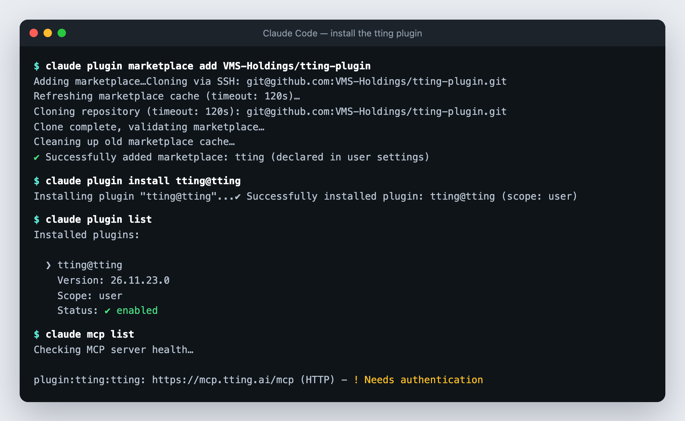
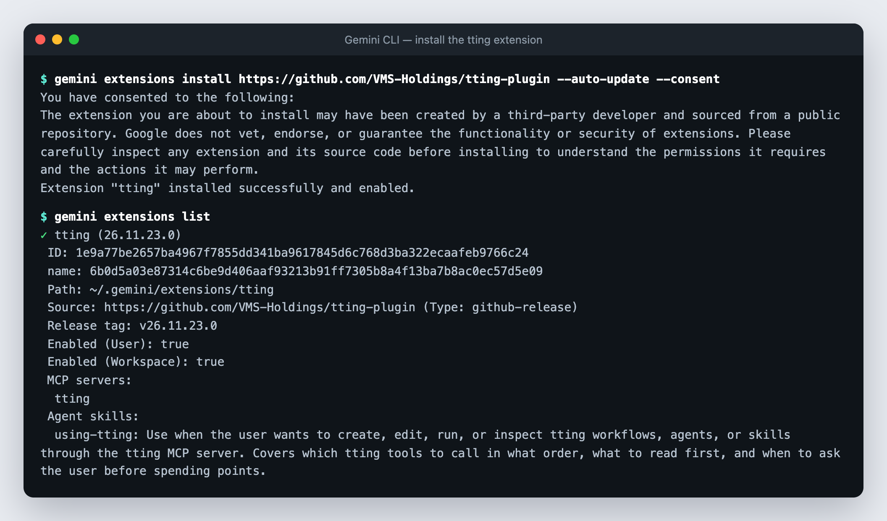
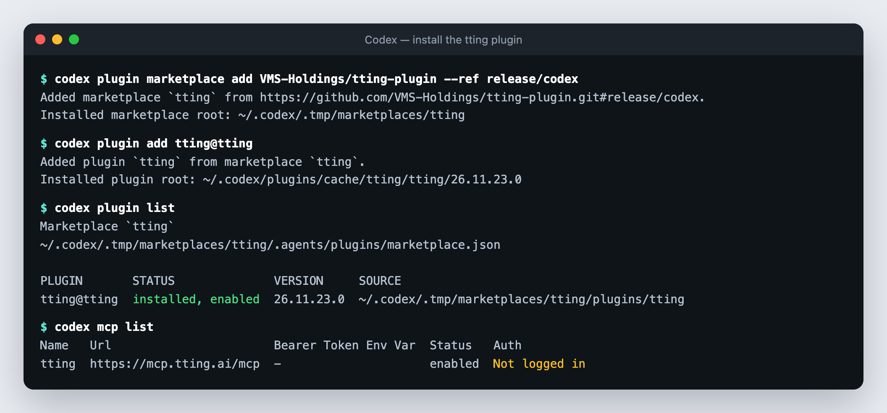
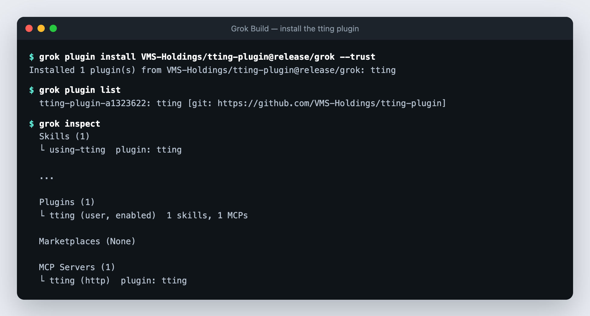
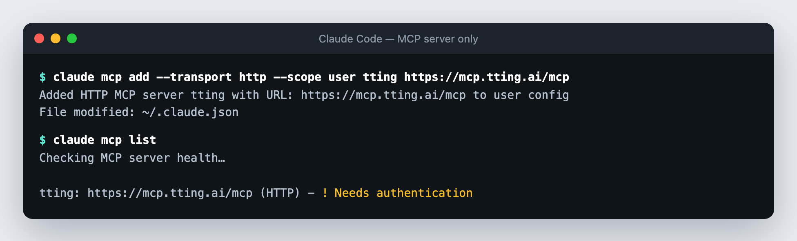
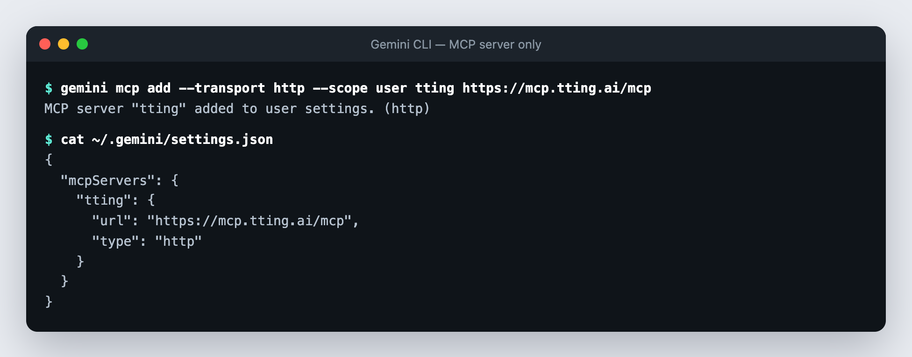
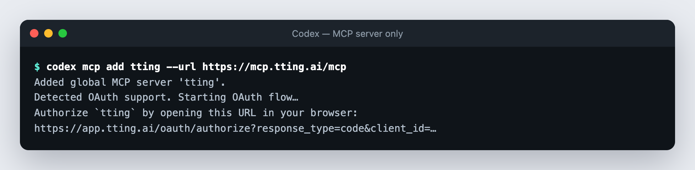
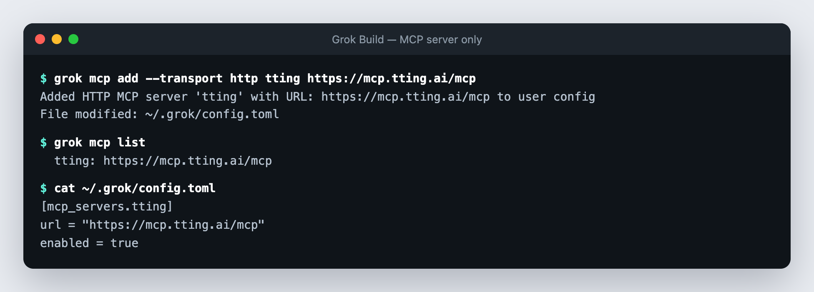
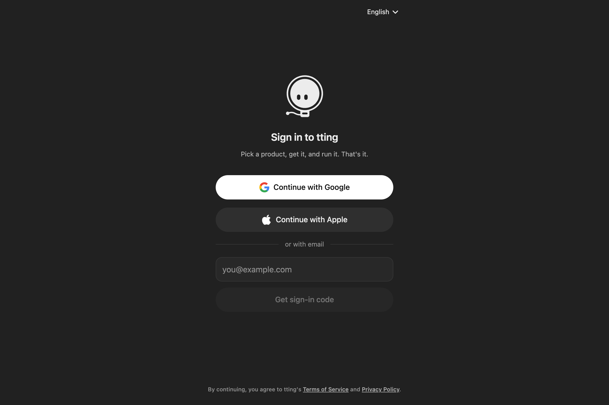

# tting plugin for coding agents

Use [tting](https://tting.ai) from the coding agent you already work in. Ask your agent to create, edit, run, and inspect tting workflows, agents, and skills, and it does the work in your tting workspace.

The plugin adds two things to your agent:

- **The tting MCP server** (`https://mcp.tting.ai/mcp`). It gives the agent the tting tools. You sign in with your tting account in the browser. No API key is needed.
- **A skill** (`using-tting`). It tells the agent which tting tools to call in what order, and when to ask you first, for example before a run spends points.

If you only want the tools, skip the plugin and [add the MCP server by itself](#mcp-server-only-no-plugin).

## Quick install

| Agent | Command |
| --- | --- |
| [Claude Code](#claude-code) | `claude plugin install tting --marketplace VMS-Holdings/tting-plugin` |
| [Gemini CLI](#gemini-cli) | `gemini extensions install https://github.com/VMS-Holdings/tting-plugin --auto-update` |
| [Codex](#codex) | `codex plugin marketplace add VMS-Holdings/tting-plugin --ref release/codex`<br>`codex plugin add tting@tting` |
| [Grok Build](#grok-build) | `grok plugin install VMS-Holdings/tting-plugin@release/grok` |
| Anything else that speaks MCP | [Add the MCP server only](#mcp-server-only-no-plugin) |

After installing, [sign in to tting](#sign-in-to-tting) once and [try a first prompt](#try-it).

You need a tting account. Create one at [app.tting.ai](https://app.tting.ai).

## Install the plugin

The screenshots below show each command and its output with plugin version `26.11.23.0`. Tool versions used: Claude Code 2.1.311, Gemini CLI 0.26.0, Codex CLI 0.172.0, Grok Build 1.0.92.

### Claude Code

Run this in your terminal:

```bash
claude plugin install tting --marketplace VMS-Holdings/tting-plugin
```

That is short for the two steps below, which you can also run one at a time:

```bash
claude plugin marketplace add VMS-Holdings/tting-plugin
claude plugin install tting@tting
```

Or, inside a Claude Code session:

```text
/plugin marketplace add VMS-Holdings/tting-plugin
/plugin install tting@tting
```

Check that it worked with `claude plugin list` and `claude mcp list`. The tting server shows `Needs authentication` until you sign in.



To sign in, start `claude`, type `/mcp`, select **tting**, and choose **Authenticate**.

### Gemini CLI

```bash
gemini extensions install https://github.com/VMS-Holdings/tting-plugin --auto-update
```

Gemini CLI shows a notice about third-party extensions and asks you to confirm. Add `--consent` to accept it up front. `--auto-update` keeps the extension on the latest release.

Check that it worked with `gemini extensions list`. You should see the `tting` MCP server and the `using-tting` skill.



To sign in, start `gemini` and run `/mcp auth tting`.

The install command works on macOS, Linux, and Windows. On other platforms, install from the release branch instead:

```bash
gemini extensions install https://github.com/VMS-Holdings/tting-plugin --ref release/gemini --auto-update
```

### Codex

```bash
codex plugin marketplace add VMS-Holdings/tting-plugin --ref release/codex
codex plugin add tting@tting
```

You can also install it from the plugin browser: run the first command, start `codex`, type `/plugins`, and install **tting**.

Check that it worked with `codex plugin list` and `codex mcp list`. The tting server shows `Not logged in` until you sign in.



To sign in, run:

```bash
codex mcp login tting
```

Start a new Codex session after installing so it picks up the skill and the tools.

### Grok Build

```bash
grok plugin install VMS-Holdings/tting-plugin@release/grok
```

Grok asks whether you trust the plugin. Add `--trust` to accept it up front.

Check that it worked with `grok plugin list`. `grok inspect` also shows the `using-tting` skill and the `tting` MCP server that came with the plugin.



To sign in, start `grok`, type `/mcps`, select **tting**, and press `i` to authenticate. Grok also starts the browser sign-in the first time a tting tool is used.

To try the plugin for one session without installing it:

```bash
git clone --branch release/grok https://github.com/VMS-Holdings/tting-plugin.git tting-grok
grok --plugin-dir ./tting-grok
```

## MCP server only (no plugin)

The plugin is optional. Any MCP client that supports remote servers can connect to tting directly. You get every tting tool, but not the `using-tting` skill.

| Setting | Value |
| --- | --- |
| Server URL | `https://mcp.tting.ai/mcp` |
| Transport | Streamable HTTP |
| Authentication | OAuth 2.1 in the browser. Clients register themselves, so you do not need a client ID, secret, or API key. |

### Claude Code

```bash
claude mcp add --transport http --scope user tting https://mcp.tting.ai/mcp
```

`--scope user` makes the server available in every project. Leave it out to add the server to the current project only. Then start `claude`, type `/mcp`, select **tting**, and choose **Authenticate**.



### Gemini CLI

```bash
gemini mcp add --transport http --scope user tting https://mcp.tting.ai/mcp
```

Then start `gemini` and run `/mcp auth tting`. The command writes this to `~/.gemini/settings.json`, which you can also edit by hand:

```json
{
  "mcpServers": {
    "tting": {
      "url": "https://mcp.tting.ai/mcp",
      "type": "http"
    }
  }
}
```



### Codex

```bash
codex mcp add tting --url https://mcp.tting.ai/mcp
```

Codex detects OAuth and opens the browser sign-in right away. To sign in again later, run `codex mcp login tting`. The command writes this to `~/.codex/config.toml`:

```toml
[mcp_servers.tting]
url = "https://mcp.tting.ai/mcp"
```



### Grok Build

```bash
grok mcp add --transport http tting https://mcp.tting.ai/mcp
```

Then start `grok`, type `/mcps`, select **tting**, and press `i` to authenticate. The command writes this to `~/.grok/config.toml`:

```toml
[mcp_servers.tting]
url = "https://mcp.tting.ai/mcp"
enabled = true
```



### Other clients

The steps below follow each client's own documentation. We have not run them ourselves. If a client changes its menus, its documentation wins.

**Claude (claude.ai and Claude Desktop).** Open **Customize > Connectors**, click **+ Add**, then **Add custom connector**. Enter a name and the server URL, click **Continue**, keep the default sign-in options, and click **Add**. On Team and Enterprise plans an owner adds the connector first under **Organization settings > Connectors**. See [Getting started with custom connectors](https://support.claude.com/en/articles/11175166-getting-started-with-custom-connectors-using-remote-mcp).

**ChatGPT.** Go to [chatgpt.com/plugins](https://chatgpt.com/plugins), select the plus button, then **Add custom MCP server**. Enter a name and the server URL, choose **OAuth** for authentication, and create it. Install it before you use it in a conversation. See [Developer mode](https://developers.openai.com/api/docs/guides/developer-mode).

**Cursor.** Add this to `~/.cursor/mcp.json` (all projects) or `.cursor/mcp.json` (one project). See [Cursor MCP docs](https://cursor.com/docs/context/mcp).

```json
{
  "mcpServers": {
    "tting": {
      "url": "https://mcp.tting.ai/mcp"
    }
  }
}
```

**VS Code.** Run **MCP: Add Server** from the Command Palette, choose **HTTP (HTTP or Server-Sent Events)**, and enter the server URL. See [Use MCP servers in VS Code](https://code.visualstudio.com/docs/copilot/customization/mcp-servers).

**Any other client.** Look for "remote MCP server", "custom connector", or "streamable HTTP" in its settings and enter the server URL. If the client asks for an authentication type, choose OAuth.

## Sign in to tting

The first time your agent connects, it opens the tting sign-in page in your browser. Sign in, approve the access request, and return to your agent. The connection is bound to one tting workspace.



The agent asks for three permissions: read your workspace (`mcp:read`), create and edit workflows, agents, and skills (`mcp:write`), and run them (`mcp:run`).

## Try it

Ask your agent in plain language. For example:

- "Check my tting connection and tell me which workspace I'm in."
- "List my tting workflows."
- "Create a tting workflow that summarizes a URL I give it, and show me the draft before you save it."
- "Run the workflow named Daily digest and show me the result."

Running workflows and agent tests spends your workspace's points. With the plugin installed, the agent tells you before it spends them.

## What the agent can do

| Area | Tools |
| --- | --- |
| Connection | `whoami` |
| Workflows | `get_workflow_spec`, `list_workflows`, `get_workflow`, `create_workflow`, `save_workflow_draft`, `run_workflow`, `get_workflow_run`, `get_workflow_run_task` |
| Agents | `list_agents`, `get_agent`, `create_agent`, `update_agent`, `list_agent_versions`, `get_agent_version`, `restore_agent_version`, `estimate_agent_test_run`, `start_agent_test_run` |
| Skills | `list_skills`, `get_skill`, `create_skill`, `update_skill` |

The server may offer more tools than this table lists. Your client shows the full list after you sign in.

## Update and uninstall

| Agent | Update | Uninstall |
| --- | --- | --- |
| Claude Code | `claude plugin update tting@tting` | `claude plugin uninstall tting@tting`<br>`claude plugin marketplace remove tting` |
| Gemini CLI | `gemini extensions update tting` | `gemini extensions uninstall tting` |
| Codex | `codex plugin marketplace upgrade tting` | `codex plugin remove tting@tting`<br>`codex plugin marketplace remove tting` |
| Grok Build | `grok plugin update tting` | `grok plugin uninstall tting` |

If you added the MCP server only, remove it with your client's own command, for example `claude mcp remove tting`.

## Troubleshooting

- **The server shows "Needs authentication", "Not logged in", or "Disconnected".** That is the state before sign-in. Follow the sign-in step for your agent above.
- **The browser did not open.** Copy the authorization URL your agent prints and open it yourself. In Codex, `codex mcp login tting` prints it again.
- **`AI_CONSENT_REQUIRED`.** AI processing is turned off for your account. Turn it on in tting Settings.
- **`POINT_BALANCE_EXHAUSTED`.** The workspace is out of points. Retrying will not help until points are added.
- **The tools are there but the agent uses them badly.** You probably added the MCP server without the plugin. Install the plugin to get the `using-tting` skill.

Found a problem with the plugin? [Open an issue](https://github.com/VMS-Holdings/tting-plugin/issues).

## How this repository works

One source builds a plugin for every agent, and all of them are released together under one version.

| Agent | Installs from | Format |
| --- | --- | --- |
| Claude Code | `release/claude` branch, through the marketplace file on `main` | Plugin: `.claude-plugin/plugin.json`, `.mcp.json`, `skills/` |
| Gemini CLI | The Gemini bundle of the latest GitHub Release | Extension: `gemini-extension.json`, `skills/` |
| Codex | `release/codex` branch | Marketplace and portable plugin: `.agents/plugins/marketplace.json`, `plugins/tting/` |
| Grok Build | `release/grok` branch | Same format as Claude Code |

Versions are the release date plus a counter for that day, written `yy.mm.dd.n`. The first release on 23 November 2026 is `26.11.23.0`, tagged `v26.11.23.0`.

To change the plugin or add a skill, read [CONTRIBUTING.md](CONTRIBUTING.md). Maintainers release with [docs/RELEASING.md](docs/RELEASING.md).
